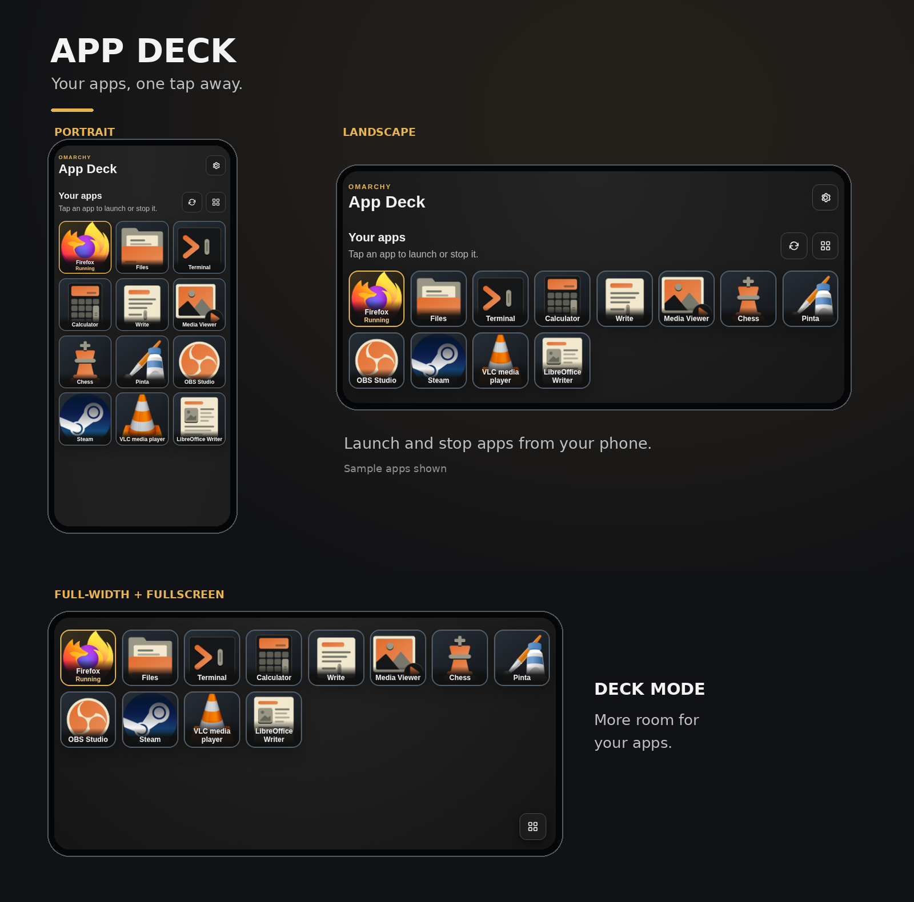
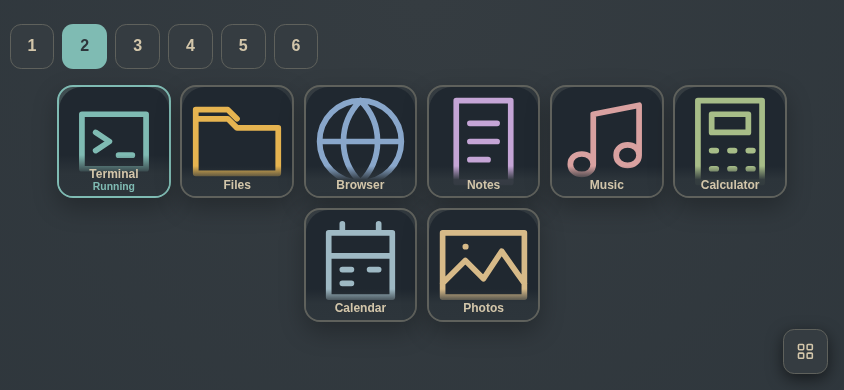

# App Deck

Launch and manage selected Omarchy applications from a phone using a trusted
HTTPS connection.

App Deck is an Omarchy Quattro bar plugin with a small local Python service and
a mobile-friendly browser interface. On the phone, use **Configure** to choose
installed desktop apps, then tap a card to launch or stop an App Deck-managed
instance.



*Preview uses sample apps and simulated running states.*

Use **Deck mode** to hide the header and controls and request fullscreen.
**Show controls** restores them and exits fullscreen; the browser's exit
gesture also leaves Deck mode. Browsers require a fresh tap for fullscreen
after a page reload, even when Deck mode is remembered. Configuration also
offers four card sizes, a full-width option, and links to report bugs or request
features on GitHub.
Display preferences are saved in that browser.



> **Security:** A trusted HTTPS reverse proxy is required. Never bypass browser
> certificate warnings or expose App Deck to the public internet.

## Planned for the next release

- Drag-to-reorder app cards.
- Individual paired-device management.
- Workspace selector buttons at the top of the page.
- Explore an installable home-screen web app.

## Install and connect

On Omarchy Quattro, review the repository and then install and enable it:

```sh
omarchy plugin add https://github.com/kelmankenberg/AppDeck.git --enable
```

Configure a trusted HTTPS reverse proxy before pairing. The proxy must forward
requests to `http://127.0.0.1:8765`, preserve the original `Host` header and
restrict access to trusted devices. Do not expose the HTTP backend on the
network or enable public forwarding.

Choose one of these proxy setups:

- **Tailscale Serve:** Install and connect Tailscale on the PC and phone,
  enable HTTPS for your tailnet, and select an unused HTTPS port. For example,
  `tailscale serve --bg --https=8443 http://127.0.0.1:8765` makes the service
  available only within the tailnet. Check `tailscale serve status` first so
  you do not overwrite an existing service. Use the HTTPS URL shown by Serve.
  Certificate provisioning publishes the device's DNS name in a public
  certificate transparency log. See the [Tailscale Serve documentation](https://tailscale.com/docs/features/tailscale-serve).
- **LAN HTTPS proxy:** Configure a reverse proxy with an HTTPS certificate that
  the phone's browser trusts for its exact hostname or IP address. Restrict its
  listener and firewall to your trusted LAN. Certificate issuance, phone
  trust, renewal, and hostname resolution depend on your proxy and network.
  A self-signed certificate accepted through a browser warning is not a
  substitute for trusted server authentication.

For example, a Caddy configuration using an already trusted certificate could
look like this (replace the hostname, LAN address, and certificate paths):

```caddyfile
https://deck.example:8443 {
    bind 192.168.1.10
    tls /path/to/certificate.pem /path/to/private-key.pem
    reverse_proxy 127.0.0.1:8765
}
```

Create `~/.config/appdeck/connection.json` with the exact HTTPS origin, for
example:

```json
{"origin": "https://your-device.example:8443"}
```

Reload the plugin, then click its bar icon to see the address, pairing code,
and optional QR code. Scan the QR code or open the HTTPS address and enter the
pairing code. Use the gear button to select apps. If the certificate is not
trusted or the proxy cannot reach the local backend, fix the proxy before
pairing; do not bypass certificate warnings.

The service needs Python 3. `qrencode` is optional for QR pairing; PyGObject,
GTK 4 and GdkPixbuf are optional for app icons. Without them, use manual
pairing or the initial-based icon placeholders respectively.

## Remove

```sh
omarchy plugin remove kelmankenberg.appdeck
```

Removal unloads the plugin, but does not delete its selected-app and process
tracking data or connection settings in `~/.config/appdeck/` and
`~/.local/state/appdeck/`. Browser preferences are stored separately in each
browser. Remove the App Deck proxy route separately; do not reset unrelated
Tailscale Serve or reverse-proxy routes.

## Development

The service uses Python 3 and the standard library. `qrencode` is optional; when
installed, App Deck shows a QR code that opens and pairs the phone page. Without
it, enter the displayed address and pairing code manually.
App icons use PyGObject, GTK 4 and GdkPixbuf when available; missing icons fall
back to an initial.

Run the focused service tests with:

```sh
python3 -m unittest discover -s tests
```

Validate the plugin from an Omarchy Quattro system with:

```sh
omarchy plugin validate .
```

## Security and behavior

- The backend binds only to `127.0.0.1:8765` and requires an HTTPS reverse
  proxy. It does not expose a shell endpoint. Other local processes on the PC
  are within the trust boundary.
- Manual pairing uses an eight-digit code, with a global limit of five failed
  attempts per five minutes. It exchanges the code for the same random per-run
  bearer token used by QR pairing. Both change when the service restarts. The
  API only accepts configured desktop-app IDs and launch/stop actions.
- HTTPS protects the phone-to-proxy connection only when the certificate and
  hostname are trusted. The proxy-to-backend connection is local HTTP; local
  processes and proxy administrators remain within the trust boundary.
- App Deck launches the selected desktop entry's `Exec` command without a
  shell. Stop targets only the process group App Deck started. Apps that hand
  off to a pre-existing single-instance process may not be trackable or
  stoppable through App Deck.
- The selected app IDs are stored in
  `~/.config/appdeck/apps.json`. Tracked process IDs are stored in
  `~/.local/state/appdeck/runs.json` so a shell reload can retain stop controls.

## License

App Deck is licensed under the [MIT License](LICENSE).
