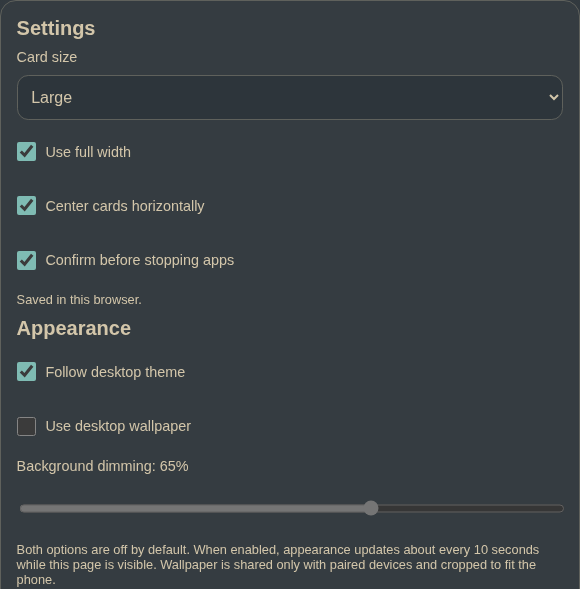

# App Deck

Launch and manage selected Omarchy applications from a phone using a trusted
HTTPS connection.

App Deck is an Omarchy Quattro bar plugin with a small local Python service and
a mobile-friendly browser interface. On the phone, use **Configure** to choose
installed desktop apps, then tap a card to launch or stop an App Deck-managed
instance. Hold and drag a card to reorder it; the order is shared with paired
phones. Keyboard users can move a focused card with Alt+Left or Alt+Right.
The numbered **Workspaces** buttons switch the focused monitor's workspaces
and highlight its active workspace. Like Omarchy's built-in workspace widget,
App Deck shows the first five slots and adds other workspaces when they exist,
including visiting workspaces. For example, workspace 6 appears when you use
it and can disappear when it no longer exists. Third-party workspace widgets
such as Spaces may be configured to show more empty slots than App Deck.


*Previews use sample apps, original generic icons, and simulated running states.
The fullscreen example has desktop colors and horizontal centering enabled.*

Use **Deck mode** to hide the header and controls and request fullscreen.
**Show controls** restores them and exits fullscreen; the browser's exit
gesture also leaves Deck mode. Browsers require a fresh tap for fullscreen
after a page reload, even when Deck mode is remembered. Configuration also
offers four card sizes, a full-width option, and links to report bugs or request
features on GitHub.
Display preferences are saved in that browser.
Enable **Center cards horizontally** in Settings to center each row of app
cards, including a partially filled last row. It preserves the chosen card
size, existing gaps, and page padding, works with **Use full width**, and does
not affect the configuration list. It is off by default and saved per browser.
Enable **Confirm before stopping apps** in Settings to ask before stopping a
running app, with a warning about unsaved work. This option is off by default,
is saved in that browser, and does not affect launching apps.

Under **Settings → Appearance**, **Follow desktop theme** mirrors the active
Omarchy palette, while **Use desktop wallpaper** shows the current still
wallpaper with adjustable **Background dimming** (65% initially). Both options
are off by default, preserving App Deck's original appearance; turn them off
to restore it. Choices are saved per browser.

When either option is enabled, App Deck checks for desktop appearance changes
about every 10 seconds while the paired page is visible. Wallpapers are resized
for phones and cropped to fill the screen. Any paired device can retrieve the
desktop palette and wallpaper; these options control display in that browser,
not access permissions. Pair only devices you trust, especially if your
wallpaper contains personal information. PNG, JPEG, and WebP still images
up to 32 MB are supported; videos and animated desktop effects are not mirrored.
Unavailable colors or images produce an error and use App Deck's default
appearance for that part without disabling app controls.

To add App Deck to your phone's home screen as a standalone app, open
**Configure → Home screen** and tap **Install App Deck** when available.
Otherwise, use your browser's menu (or Share on iPhone) and choose **Install
app** or **Add to Home Screen**. The wording and standalone support depend on
the browser; some browsers create a regular shortcut instead. The app opens the
connection address used to install it, so that address must still be reachable
and trusted. You may need to pair again in the installed app if it uses separate
storage from the browser tab. Pairing is remembered across visits until revoked
or the site's browser data is cleared.




> **Security:** A trusted HTTPS reverse proxy is required. Never bypass browser
> certificate warnings or expose App Deck to the public internet.

## Install and connect

On Omarchy Quattro, review the repository and then install and enable it:

```sh
omarchy plugin add https://github.com/kelmankenberg/AppDeck.git --enable
```

Click the App Deck bar icon and open **Connection setup**. Up to two HTTPS
addresses can be used at once; choose the appropriate connection in the popup
to display its QR code. Pairing survives service and shell restarts and browser
relaunches; a different connection address or browser profile requires its own
pairing.

- **Tailscale:** Connect Tailscale on the PC and phone and enable MagicDNS and
  HTTPS for your tailnet. Click **Set up Tailscale** to reuse an existing
  App Deck Serve route or add a new private route on an unused port. If the
  current user cannot change Serve, the setup panel provides the administrator
  command to run and then retry. HTTPS certificate provisioning publishes the
  device's DNS name in a public certificate transparency log. See
  [Tailscale Serve](https://tailscale.com/docs/features/tailscale-serve).
- **LAN HTTPS:** Set up an existing trusted reverse proxy, enter its HTTPS
  origin in the setup panel, and click **Add LAN address**. App Deck does not
  automatically discover, install, or configure the proxy or certificate.
  The phone's browser must trust the certificate for that exact hostname or IP.
  Use the proxy address reachable by the phone, not a Docker or VPN interface
  unless the phone can reach it. If the LAN IP changes, update the proxy,
  certificate, firewall and App Deck address as needed.

The proxy must forward requests to `http://127.0.0.1:8765`, preserve the
original `Host` header and restrict access to trusted devices. Do not expose
the HTTP backend on the network or enable public forwarding. Restrict a LAN
proxy's listener and firewall to the trusted LAN. Certificate issuance, phone
trust, renewal, and hostname resolution depend on your proxy and network.
Never bypass certificate warnings.

For example, a Caddy configuration using an already trusted certificate could
look like this (replace the hostname, LAN address, and certificate paths):

```caddyfile
https://deck.example:8443 {
    bind 192.168.1.10
    tls /path/to/certificate.pem /path/to/private-key.pem
    reverse_proxy 127.0.0.1:8765
}
```

After setup, scan the QR code or open the displayed HTTPS address and enter
the pairing code. Use the gear button to select apps. If the certificate is
not trusted or the proxy cannot reach the local backend, fix the proxy before
pairing.

**Only pair devices you trust.** A paired phone can change the shared app
selection and add and launch any discovered desktop app, not just apps already
shown on the deck. It can also stop App Deck-managed instances and switch the
focused monitor's workspace and retrieve the desktop palette and wallpaper. Keep the
pairing code and QR code private.

To manage access, open **Paired devices** in the PC's App Deck bar panel.
Each paired browser or installed-app profile has its own credential. Set a name
when pairing manually, or edit the label on the PC with **Save name**. Names
are user-supplied labels, not verified hardware identities. The list shows
recent activity or the last-seen time (updated at most every 30 seconds).
Tap **Disconnect** and **Confirm disconnect** to revoke just that entry;
other devices stay paired. A request already in progress may finish.
Device management is available only on the PC, not through the phone API.

**Disconnect all phones** revokes every device and rotates the QR pairing
secret and manual code by restarting the service. Apps already launched by
App Deck are not stopped. Upgrading from the old shared-credential version
requires every phone to pair again once. Old QR codes must also be replaced.

The service needs Python 3.11 or newer. `qrencode` is optional for QR pairing; PyGObject,
GTK 4 and GdkPixbuf are optional for app icons. Without them, use manual
pairing or the initial-based icon placeholders respectively. Desktop wallpaper
previews also require PyGObject and GdkPixbuf with support for the image format.

## Remove

```sh
omarchy plugin remove kelmankenberg.appdeck
```

Removal unloads the plugin, but does not delete its selected-app and process
tracking data, paired devices, or connection settings in `~/.config/appdeck/` and
`~/.local/state/appdeck/`. Browser preferences are stored separately in each
browser. Removing an address in the setup panel or removing the plugin does
not remove its proxy route. Remove only the App Deck route separately; do not
reset unrelated Tailscale Serve or reverse-proxy routes.

## Development

The service uses Python 3.11 or newer and the standard library. `qrencode` is optional; when
installed, App Deck shows a QR code that opens and pairs the phone page. Without
it, enter the displayed address and pairing code manually.
App icons use PyGObject, GTK 4 and GdkPixbuf when available; missing icons fall
back to an initial.

Run the focused service tests with:

```sh
python3 -m unittest discover -s tests
```

Run the phone UI tests with:

```sh
node --test tests/test_ui.js
```

Validate the plugin from an Omarchy Quattro system with:

```sh
omarchy plugin validate .
```

## Security and behavior

- The backend binds only to `127.0.0.1:8765` and requires an HTTPS reverse
  proxy. It does not expose a shell endpoint. Other local processes on the PC
  are within the trust boundary.
- Manual pairing uses an eight-digit code, with a global limit of five failed
  attempts per five minutes. The pairing code changes when the service restarts.
  Manual and QR pairing issue separate random credentials for each pairing,
  with a maximum of 32 entries. Credential hashes and device labels are stored
  in private `~/.local/state/appdeck/devices.json`; the browser keeps its
  credential in local storage. The QR secret in `pairing.json` only authorizes
  new pairings, not app control. Anyone with a device credential and network
  access can control App Deck until it is revoked. The API only accepts
  discovered desktop-app IDs, supported app actions, and workspace switches
  shown on the focused monitor's workspace bar.
- HTTPS protects the phone-to-proxy connection only when the certificate and
  hostname are trusted. The proxy-to-backend connection is local HTTP; local
  processes and proxy administrators remain within the trust boundary.
- App Deck launches the selected desktop entry's `Exec` command without a
  shell. Stop targets only the process group App Deck started. Apps that hand
  off to a pre-existing single-instance process may not be trackable or
  stoppable through App Deck.
- The selected app IDs are stored in
  `~/.config/appdeck/apps.json`. Tracked process IDs are stored in
  `~/.local/state/appdeck/runs.json` so a shell reload can retain stop controls.
- While a paired phone page is visible, it checks workspace state about every
  two seconds to reflect changes made on the desktop or another phone.

## License

App Deck is licensed under the [MIT License](LICENSE).
